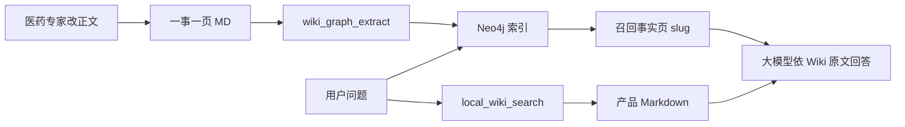
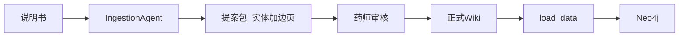

# 双层知识图谱 Schema（产品 + 临床）

> 副本专用：`/Users/edwin.zhou/Documents/LLM-WIKI-GRAPH/medical`  
> **Wiki = 事实本体（专家可改的完整正文）；Graph = RAG 检索索引。**

## 与「LLM Wiki Pattern」的关系

对齐：Wiki 为 Source of Truth，图由 Wiki **编译**而来；专家改正文、可 Git 审计回滚。  
刻意差异：

- **边一事一页**（不是「一页一节点、正文列表抽边」）
- **确定性 `graph:` frontmatter**（不用 LLM 从散文猜边类型）
- 开放产品问走 **本地全文检索**，不把长文塞进 Neo4j 节点属性

## 核心原则

1. **一事一页**：每条图谱关系对应一篇 Markdown（含完整中文正文）。
2. 文首 `graph:` 仅声明 `kind/type/from/to`（及实体 `aliases`），供灌图与召回定位。
3. Neo4j **不**保存独立于 Wiki 的事实；由 `graph/load_data.py` 从事实页派生。
4. 问答：**Graph-first** 多跳定位 → 加载 Wiki 原文；开放产品问由 **本地全文检索**（`local_wiki_search`）补页。本副本不依赖 gbrain。



## 谁维护 frontmatter？（专家撰写契约）

**医药专家日常不写英文边类型 / Neo4j label。** `graph.type` 是机器契约，由目录与脚手架决定。

| 角色 | 维护什么 | 不维护什么 |
|------|----------|------------|
| 知识架构师 / 工程 | 闭集边类型、目录→`type` 映射、label 规则、`audit`/`lint` | 禁忌机理正文 |
| 系统（建页 / 灌图） | 缺省 `type` 时按目录推断；校验目录与 `type` 一致 | — |
| 医药专家 | 中文标题与正文；两端点规范名（`[[wikilink]]`）；实体页 `aliases` 同义词 | 英文关系枚举、自创边类型 |

### 目录 → 边类型（与 `wiki_graph_extract.FOLDER_TO_REL` 一致）

| Wiki 目录 | `graph.type` | 中文关系 |
|-----------|--------------|----------|
| `临床事实/诊断` | `DIAGNOSES` | 诊断 |
| `临床事实/处方` | `PRESCRIBES` | 处方用药 |
| `临床事实/过敏` | `ALLERGIC_TO` | 过敏 |
| `临床事实/医嘱检查` | `ORDERS` | 开具检查 |
| `临床事实/医嘱手术` | `ORDERS` | 施行手术 |
| `临床事实/检查提示` | `SHOWS` | 检查提示 |
| `临床事实/设备使用` | `USES` | 使用设备 |
| `用药安全/相互作用` | `INTERACTS_WITH` | 药物相互作用 |
| `用药安全/禁忌` | `CONTRAINDICATED_FOR` | 用药禁忌 |
| `用药安全/设备互斥` | `CONTRAINDICATED_WITH` | 设备互斥 |
| `用药安全/治疗` | `TREATS` | 治疗 |
| `产品桥接/含成分` | `HAS_INGREDIENT` | 含有成分 |
| `产品桥接/适应症` | `INDICATED_FOR` | 适应症 |
| `产品桥接/系列归属` | `IN_SERIES` | 所属系列 |
| `产品桥接/采用技术` | `USES_TECH` | 采用技术 |

新建禁忌：在 `用药安全/禁忌/` 下建页 → 填中文两端点与正文 → `type` 由目录约定（或模板预填）。新关系种类 = 架构变更（改本表 + 代码闭集），不是专家在单页发明。

`audit_wiki_graph.py` 会校验：**目录与 `graph.type` 不一致 → FAIL**。

## Wiki 目录

| 目录 | 内容 |
|------|------|
| `临床病例/` | 患者叙事（实体页） |
| `临床事实/诊断|处方|过敏|…` | 临床关系事实页 |
| `用药安全/禁忌|相互作用|设备互斥|治疗` | 安全/治疗关系事实页 |
| `疾病/` `成分/` `设备/` | 实体定义页 |
| `产品桥接/含成分|适应症|系列归属|采用技术` | 产品层关系事实页 |
| `处方药/` 等 | 产品实体页 |
| `关系索引.md` | 全部边总览（自动生成） |

## 实体别名与消歧

实体页可声明（专家可改）：

```yaml
graph:
  kind: entity
  label: Drug
  aliases:
  - 盐酸二甲双胍
  - metformin
  props:
    name: 二甲双胍
```

- 灌图：`aliases` 写入 Neo4j 节点属性  
- 召回：别名映射到规范名与同一 Wiki slug（见 `build_alias_index`）  
- Gardener：`python graph/lint_entity_duplicates.py` **只报告**疑似重复，不自动合并  
- 流程：Lint 提案 → 专家合并页 / 改 links / 整理 aliases → `python graph/load_data.py`

## 说明书规模化入库（对照 LLM Wiki / Gemini）

说明书（PI）体量大时：**Ingestion Agent 起草 → 药师审核 → 正式 Wiki → `load_data` 灌图**。  
与 Gemini「Agent 写草稿、人只审」一致；**刻意不同**：

| 不要 | 要 |
|------|-----|
| 把相互作用全塞进成分实体页再 LLM 抽边 | **一事一页**：每条禁忌/相互作用单独事实页 |
| 把 severity/mechanism 只存 Neo4j 边属性 | **写在边事实页正文**（给人审 + RAG）；图边保持瘦索引 |
| 未审 `direct` 写入临床边 | 说明书默认 **review / pi** 审核模式 |

### 流程



### Agent 产出（提案包 `pages[]`）

1. 成分/疾病等 **实体页**（可含 `aliases`）  
2. 多条 **边事实页**，路径决定 `graph.type`（见上表）  
3. 严重程度与机理写在该页「结论 / 详细说明」

上传模式：`pi`（说明书审核）或带 `.pi.txt` / 文件名含「说明书」时走说明书提示词。批准后写盘并触发本地检索 sync；图需 `python graph/load_data.py`（批准 pi 提案时会后台尝试灌图）。

试点：`python graph/pi_pilot_proposal.py` → 审核 UI 或 `--apply` → smoke。

## 事实页示例（禁忌）

见 [`用药安全/禁忌/二甲双胍-慢性肾病.md`](用药安全/禁忌/二甲双胍-慢性肾病.md)：专家改正文；`graph:` 只保留边声明（由迁移/模板生成）。

## Neo4j Labels / 关系

与既有双层模型一致（Patient/Record/Drug/Condition/Product/… 及桥接边）。`HAS_RECORD` 由患者临床事实边自动派生，无单独 Wiki 页。

## 维护流程

1. 新增/修改关系 → 在对应目录建/改事实页正文（两端点中文名）  
2. `python graph/render_wiki_relations.py` → 刷新关系索引  
3. `python graph/load_data.py` → 灌 Neo4j  
4. `python graph/lint_entity_duplicates.py` → 实体消歧告警（可选）  
5. `python smoke_graph_recall.py` → 审计 + 召回冒烟  

## 诚实边界

假患者 + 真实产品页混合，仅用于架构演示，不是临床决策系统。
