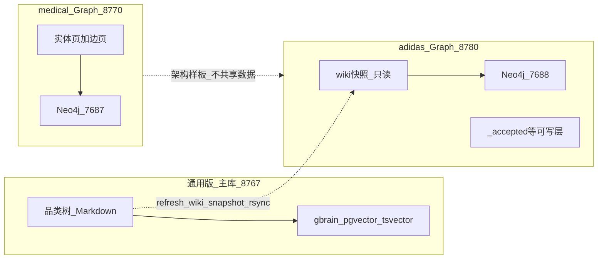

# 三系统对比：adidas Wiki · adidas Graph · medical Graph

本文对比三个并行存在、职责不同的知识库系统：

| 简称 | 路径 | 一句话定位 |
|------|------|------------|
| **通用版 / adidas llm-wiki** | `/Users/edwin.zhou/Documents/LLM-Wiki/通用版LLM-WIKI-KB` | adidas 产品 Wiki **主库**：gbrain 双通道 RAG + 完整入库/维护门户 |
| **adidas Graph** | `/Users/edwin.zhou/Documents/LLM-WIKI-GRAPH/adidas` | 产品域 **图优先** 副本：frontmatter 派生五类边 + 自包含 wiki 快照 |
| **medical Graph** | `/Users/edwin.zhou/Documents/LLM-WIKI-GRAPH/medical` | 医药域 **图优先** 样板：「一事一页」边页 + 临床/桥接多层图 |

三者可同时运行，但端口、容器、写入边界互不共享。事实以当前仓库状态为准（adidas 已落地隔离 B 与 `series_family_listing`）。

---

## 1. 总览与谱系

**谱系关系：**

1. **通用版**是 adidas 产品知识的生产/维护主库；专家改 Markdown、上传入库、语义问答都在这里完成。
2. **adidas Graph** 从通用版 **物理快照** 五类目录到本仓 `wiki/`，再确定性抽边灌入独立 Neo4j；运行时 **零依赖** 通用版路径，也 **绝不读写** medical。
3. **medical Graph** 与 adidas 产品内容无关；它提供 Graph-first 的工程样板（改写门、Cypher 模板、jieba FTS、SSE 门户），adidas Graph **借骨架、换边模型与领域**。

---

## 2. 定位对照表

| 维度 | 通用版（adidas llm-wiki） | adidas Graph | medical Graph |
|------|---------------------------|--------------|---------------|
| 品牌 / 展示名 | adidas Product Knowledge Hub | adidas 产品知识库 (Graph 副本) | fushun 医药知识库 (Graph 副本) |
| HTTP 端口 | **8767** | **8780** | **8770** |
| Neo4j | 无 | bolt **7688** / browser **7475**（`neo4j/<REMOVED>`） | bolt **7687** / browser **7474**（`neo4j/<REMOVED>`） |
| 检索后端 | **gbrain**（tsvector + pgvector，`~/.gbrain-llm-wiki`） | **Cypher 模板** + jieba FTS 兜底 | **Cypher 多层模板** + jieba FTS |
| 「图谱」含义 | D3 `graph-data.json`（wikilink 可视化，非图库） | Neo4j 类型化索引 | Neo4j 类型化索引 |
| 事实源 | 本目录 Markdown（可写） | 本仓 `wiki/` 快照（只读）+ overlay | 本目录 Markdown（含边页） |
| 写入边界 | 可写源 KB；`_proposals` / enrich | 仅 `_uploads/_proposals/_accepted/_meta` | 源 KB + proposals；边页维护重 |
| hermes / gbrain 运行时 | **依赖** | **不依赖**（DeepSeek key 可选自 `~/.hermes/.env`） | Q&A **不依赖** gbrain；上传管线可保留 hermes |
| 领域层 | 产品 + 科技 + 系列 | 同左（无 clinical） | product + **clinical** + **bridge** |

**易混淆点：** 通用版门户里的「3D 知识图谱」不是 Neo4j。两个 Graph 副本才把关系放进图数据库，且图只做召回定位。

---

## 3. 知识表示与边模型（核心差异）

### 3.1 通用版：散文 + 受控 frontmatter + wikilink

- 目录由 `kb-config.yml` 驱动：`运动表现产品` / `三叶草产品` / `轻运动产品` / `科技` / `系列` 等。
- 产品页典型字段：`title`, `brand`, `type`, `series`, `attributes`, `tags`, `description`。
- 关系主要靠正文 `[[科技/...]]`、`[[系列/...]]` 与系列页「产品列表」表达；**没有**闭集边类型灌进图库。
- 适合人类阅读与语义检索；不适合「确定性多跳切片」（例如精确枚举某科技下的全部产品、或某家族下全部子系列）。

### 3.2 adidas Graph：frontmatter 派生五边（不为边单独开页）

节点（5）：`Product` / `Tech` / `Series` / `Category` / `ProductType`。

边（闭集 5）：

| 边 | 含义 | 派生来源 |
|----|------|----------|
| `IN_SERIES` | 产品 ∈ 系列 | 产品 `series:` |
| `USES_TECH` | 产品用科技 | `tags:` 中 `科技/xxx` + `attributes`∩科技 slug |
| `IN_CATEGORY` | 产品 ∈ 品类 | 顶层目录名 |
| `HAS_TYPE` | 产品类型 | `type:`（鞋/服装/配件） |
| `SERIES_USES_TECH` | 系列宣称科技 | 系列页「核心技术」wikilink |

实现见 `adidas/graph/wiki_graph_extract.py`、`adidas/SCHEMA.md`。

**维护含义：** 改通用版 frontmatter → 刷新快照 → `load_data.py` 重灌，图即更新。专家不必手写边类型英文名。

**已知损耗：** Product 以文件名 stem 为 `name`，跨品类同 stem 可能合并；`series:` 存在噪声值时会污染 Series 节点。

### 3.3 medical Graph：一事一页边事实

- 每条图谱关系 = 独立 Markdown，`graph.kind: edge` + `type/from/to`（及 labels）。
- 节点涵盖 `Patient` / `Drug` / `Condition` / `Product` / `Series` 等；关系闭集约 16 种（禁忌、相互作用、适应症、成分、诊断处方等）+ 派生 `HAS_RECORD`。
- 正文写机制/理由；Neo4j **不**存独立于 Wiki 的事实正文。
- 分层：产品层 + 临床层 + 桥接层（`kb-config.yml` 的 `role`）。

详见 `medical/SCHEMA.md`。

### 3.4 结论：边模型不可互换

| 若强行… | 后果 |
|---------|------|
| 把 medical「一事一页」套到 adidas 产品图 | 数千条 `IN_SERIES`/`USES_TECH` 都要单独开页，维护爆炸；产品域本已有 frontmatter |
| 把 adidas 五边压到 medical 临床问 | 无法表达禁忌、相互作用、患者不安全用药等跨层语义 |
| 指望通用版 wikilink 可视化当 Cypher 索引 | D3 JSON 不能做参数化多跳召回与确定性空集 |

**正确分工：** 通用版养正文与字段；adidas Graph 把字段投影成产品关系索引；medical Graph 用边页承载高风险临床关系。

---

## 4. 召回与作答链路

```mermaid
flowchart TB
  subgraph generic [通用版_8767]
    G1[问句改写] --> G2[gbrain_search加query]
    G2 --> G3[jieba扩展与wikilink扩展]
    G3 --> G4[DeepSeek合成]
  end
  subgraph adidasG [adidas_Graph_8780]
    A1[改写门] --> A2[in_graph_slice与Cypher模板]
    A2 --> A3[读本仓wiki或overlay原文]
    A3 --> A4[jieba_FTS兜底]
    A4 --> A5[DeepSeek合成]
  end
  subgraph medicalG [medical_Graph_8770]
    M1[改写门] --> M2[多层Cypher模板]
    M2 --> M3[优先加载边页再实体页]
    M3 --> M4[jieba_FTS补页]
    M4 --> M5[DeepSeek合成]
  end
```

### 4.1 共同原则（两个 Graph）

**图 = 定位索引；答案 = Markdown 原文。** Cypher 返回实体名/关系切片与应读 slug；LLM 只能依据加载的正文作答，不得把图摘要当说明书。

通用版原则不同：**语义/关键词命中页 → 可选概念链扩展 → LLM**，没有「模板 ID → 确定性关系切片」这一层。

### 4.2 通用版链路要点

1. `gbrain search`（关键词）与 `gbrain query`（向量）融合。
2. jieba 拆词扩搜；DeepSeek 改写。
3. `expand_concept_links` 沿 wikilink 拉概念页，抬高召回面。
4. 端点：`/ask-stream`（默认）、`/ask-deep`（两阶段 ReAct）、`/ask`（hermes agent）。

**强项：** 模糊表述、长尾卖点、跨页叙述。  
**弱项：** 「某科技下有哪些产品」「某家族有哪些子系列」易漏页或靠 LLM 编凑未召回的名称。

### 4.3 adidas Graph 链路要点

1. `question_rewrite.py`：规则拦截 + DeepSeek JSON 改写（无 key 降级）。
2. `graph_recall.py`：`_pick_template` → 参数化 Cypher → Neo4j `7688`。
3. `build_context_block` / 门户 SSE：加载本仓 `wiki/`（或 overlay）原文。
4. 图未命中或 rows 空 → `local_wiki_search.py`（jieba FTS）。

主要模板：`products_by_tech`、`product_in_series`、`series_family_listing`、`products_in_category`、`products_by_type`、`series_tech`、`series_tech_products`、`product_overview`。

### 4.4 案例：adizero 家族系列（为何需要 `series_family_listing`）

| 问法 | 正确模板 | 错误路径的后果 |
|------|----------|----------------|
| 「climacool **系列有哪些产品**？」 | `product_in_series` | — |
| 「adizero **有哪些产品系列**？各自有什么特点？」 | `series_family_listing` | 若误路由到 `product_in_series(ADIZERO)` → 拉回大量产品页、跳过家族系列页 → LLM 可能编出若干子系列却 **漏掉** 已存在的 `ADIZERO/CLIMAWARM`（`系列/adizero-climawarm.md`） |

`series_family_listing` 用 `Series.name CONTAINS family` 召回家族下全部 Series 节点，并 **加载全部对应 `系列/*` 页**；列举集合契约为 ⊆ 召回行。这是 Graph 相对通用版语义搜的典型优势：**先定位应读哪些系列页，再作答**。

### 4.5 medical Graph 链路要点

1. 改写门与 adidas 同构，实体提示来自医药词表 / `graph-entity-map.yml`。
2. 模板覆盖患者不安全用药、禁忌、成分、跨层产品禁忌等；命中后 **优先边页 slug**。
3. FTS 在图薄、开放产品长问或模板未对齐时补页；部分系列清单靠补拉系列 Markdown 而非纯 FTS。

---

## 5. 门户、写入与运维

| 能力 | 通用版 | adidas Graph | medical Graph |
|------|--------|--------------|---------------|
| 门户 UI | `product-hub.html`（图谱+问答+上传+审核，功能最全） | medical 风格 SPA（登录/SSE/改写确认/上传审核） | 同左 + 更完整维护与说明书模式 |
| 鉴权 | `PORTAL_PASSWORD` cookie | 同左（cookie 名独立） | 同左 |
| 上传模式 | review / direct | review / direct（简化；无完整 AI 入库） | review / **pi（说明书）** / direct |
| 写入落点 | 源 KB 目录 | 仅 overlay；`assert_writable_under_kb` | 源 KB + proposals |
| 自维护 | L1/L2/L3 enrich、taxonomy validate | 任务：rebuild / validate 等轻量 | 边审计、关系索引、说明书试点等更重 |
| 可视化 | 内嵌 D3 3D 图 | 门户内图谱区；Neo4j Browser `7475` | Neo4j Browser `7474` + 独立 viz **8765** |
| 内容同步 | 主库即时 | `scripts/refresh_wiki_snapshot.sh` 人工 rsync | 本仓即主内容 |

**运维隔离红线：**

- 勿用 medical 凭据连 adidas Neo4j，反之亦然。
- adidas 快照与通用版不同步时，门户答案会落后于主库——需显式跑刷新脚本再 `load_data.py`。
- adidas / medical **禁止**写回 `/Users/edwin.zhou/Documents/LLM-Wiki/通用版LLM-WIKI-KB`（adidas 运行时已硬校验）。

---

## 6. 规模与能力边界

| | 通用版 | adidas Graph | medical Graph |
|--|--------|--------------|---------------|
| 内容规模 | 约 6.7k+ `.md` 页 | 图约 **6562** nodes / **23818** rels（与快照一致时） | 体量小；演示级病例与边页 |
| 检索强项 | 语义相似、模糊问、长文卖点 | 科技/系列/品类/类型/家族系列等 **可解释多跳** | 禁忌、相互作用、患者×产品跨层 |
| 检索弱项 | 关系枚举易漏、不可证明空集 | 依赖 frontmatter 质量与模板覆盖；开放闲聊弱于向量搜 | 边页成本高；假患者需诚实边界声明 |
| 工程复杂度 | hermes + gbrain + enrich 链最长 | 中等：抽边灌图 + 模板路由 | 高：边页契约 + 多层路由 + 审计 |

**诚实边界：**

- adidas / medical Graph 的 demo Neo4j 凭据 **非生产**。
- medical 含假患者叙事，**不是**临床决策系统。
- 通用版与 adidas Graph 回答同一产品问题时，若快照未刷新，内容可能不一致——以通用版为主库真相，Graph 为可解释检索演示/副本。

---

## 7. 何时用哪个（决策建议）

| 场景 | 推荐 | 原因 |
|------|------|------|
| 日常改产品文案、上传 PDF/DOCX、审核提案、taxonomy 自检 | **通用版** | 主库可写；入库与 enrich 完整 |
| 「哪些产品用了 boost」「某系列有哪些产品」「adizero 有哪些子系列」 | **adidas Graph** | Cypher 切片 + 系列页全量加载；可冒烟断言 |
| 「王强不宜用哪些药」「某成分禁忌哪些病」「产品活性成分」等 | **medical Graph** | 边页 + 临床/桥接模板 |
| 模糊「这双鞋缓震怎么样」类体验问 | **通用版**（或 Graph 走 FTS 兜底） | 向量/关键词更合适 |
| 同时开三个门户做演示 | 可以 | 端口已隔离：8767 / 8780 / 8770 |

**演进建议（不改变三者分工）：**

1. 通用版继续当 SoT；frontmatter 与系列页质量直接决定 adidas 图质量。
2. adidas 模板按高频问法增量扩展，而不是引入 medical 边页。
3. medical 保持边页模型；勿为了「统一」压成五边产品图。

---

## 8. 附录

### 8.1 关键路径速查

| 系统 | 根目录 | 配置 | 召回 / 服务 | 图灌入 |
|------|--------|------|-------------|--------|
| 通用版 | `.../LLM-Wiki/通用版LLM-WIKI-KB` | `kb-config.yml`, `config.py`, `gbrain.yml` | `server.py`, `gbrain.sh` | `regenerate-graph.py`（D3 JSON + gbrain sync） |
| adidas Graph | `.../LLM-WIKI-GRAPH/adidas` | `kb-config.yml`, `config.py` | `graph_recall.py`, `query.py`, `server.py` | `graph/wiki_graph_extract.py`, `graph/load_data.py` |
| medical Graph | `.../LLM-WIKI-GRAPH/medical` | `kb-config.yml`, `graph-entity-map.yml` | `graph_recall.py`, `server.py` | `graph/wiki_graph_extract.py`, `graph/load_data.py` |

其他常用：

- adidas 快照刷新：`adidas/scripts/refresh_wiki_snapshot.sh`
- adidas 冒烟：`adidas/smoke_graph_recall.py`
- medical 架构说明：`medical/PHASE4.md`
- 通用版架构：`通用版LLM-WIKI-KB/docs/SYSTEM_ARCHITECTURE.md`

### 8.2 参考文档

| 文档 | 路径 |
|------|------|
| 通用版 README | `/Users/edwin.zhou/Documents/LLM-Wiki/通用版LLM-WIKI-KB/README.md` |
| 通用版系统架构 | `.../通用版LLM-WIKI-KB/docs/SYSTEM_ARCHITECTURE.md` |
| 通用版深度检索 | `.../通用版LLM-WIKI-KB/docs/DeepSearch_ARCHITECTURE.md` |
| adidas README / SCHEMA / PLAN / PHASE | `.../LLM-WIKI-GRAPH/adidas/{README,SCHEMA,PLAN,PHASE}.md` |
| medical SCHEMA / PHASE4 | `.../LLM-WIKI-GRAPH/medical/{SCHEMA,PHASE4}.md` |

### 8.3 端口速记

| 端口 | 用途 |
|------|------|
| 8767 | 通用版门户 |
| 8770 | medical Graph 门户 |
| 8780 | adidas Graph 门户 |
| 7687 / 7474 | medical Neo4j bolt / browser |
| 7688 / 7475 | adidas Neo4j bolt / browser |
| 8765 | medical 独立图可视化（若启用） |
| 9876 | 通用版 gbrain sidecar（可选） |

---

*文档版本：与 adidas 隔离 B + `series_family_listing` 落地状态对齐。*
